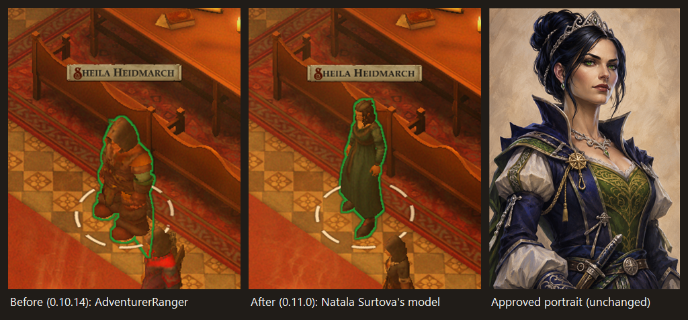
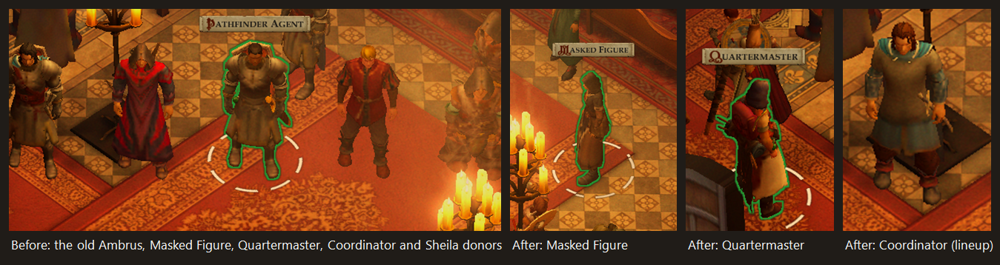

# WR-PLAYTEST-02: reliable departure, free retraining, lodge equipment and NPC looks

Branch `feature/wr-playtest-02` from `main` at `bd4fbad` (PR #9 merged, release 0.10.14). Candidate **0.11.1**.

| | |
|---|---|
| Code commit | `80587b7` |
| Package | `artifacts\KingmakerWakingRune-0.11.1.zip`, SHA-256 `0446807b2a9161120d83640c87e7c0c2695d1ee31c2ba2f50a253e295e69f535` |
| DLL | `39ad4570ea7c9ad0b27975eb1cfce8d2d1b61233d6d17b042f16006cb9e9a929` (the package holds only `Info.json` and the DLL) |
| Superseded candidate | 0.11.0 (`39372de`, zip `0e90dbf7…5652`): tested in `wrplay2-r1`; one defect found there, fixed in 0.11.1 (see "Retraining") |
| Unit tests | 265 pass |
| Game, loader | Pathfinder: Kingmaker 2.1.7b, Unity Mod Manager 0.28.2 (the owner's log shows 0.33.0) |
| Mods in the representative runs | Mounted Combat **0.2.11** (owner's release zip `823d5f87…775e`, matches its manifest), Tabletop Rules Expansion **0.0.191** (`c09ca625…7fbb`, matches its `SHA256SUMS.txt`), Dice Roller **0.2.0** (`43f99fab…aaad`, matches its `SHA256SUMS.txt`); each installed only inside a run and removed before it ended |
| Runtime runs | `wrplay2-r1` (0.11.0 and its development builds; 0.10.14 for one shop seed), `wrplay2-r2` (0.11.0, then 0.11.1); guarded transactions, evidence `runtime-evidence\<run>` |

Labels: **PLAYER** (real mouse and keyboard input), **PARTY AI**, **HARNESS-COMMANDED** (an order or native call issued by
the harness, not UI input), **SETUP/INJECTED** (a fixture: a fault, a position, a load).

## Owner notes and results

| Owner request | Result | Where |
|---|---|---|
| 1. Failed pre-departure save | **Fixed.** Mounted Combat's deferred save made the loading queue read idle while it waited; the checkpoint now follows its own queued save to a verified end. Shared with the portal home. | "Departure save" |
| 2. Sheila should resemble her portrait | **Done.** Natala Surtova's model (upright, dark hair, long green gown) replaces the hooded ranger; no weapon. | "NPC looks" |
| (owner's note) The other NPCs too | **Done.** Masked Figure, Quartermaster and Coordinator take closer models; Ambrus keeps his. All lodge staff unarmed. | "NPC looks" |
| 3. Free retraining at the Coordinator | **Done.** Protagonist and chosen companion, native rebuild, free every time, cancel-safe, departure-aware. | "Retraining" |
| 4. No nonmagical provider weapons | **Done.** 16 plain, masterwork and cold iron lines retired; magic verified per item; supplies kept. | "Provider weapons" |
| 5. Gloves of Dueling, lesser and normal | **Done.** The native items, verified on a trained fighter and a control. | "Equipment" |
| 6. Haramakis, if any exist | **None exist** in the installed game, Call of the Wild 1.14.4c-2.1 or the provider 0.0.191; none stocked. | "Equipment" |
| 7. Native adamantine armor | **Done.** 70 native adamantine armors stocked (71 found, one duplicate excluded); damage reduction verified. | "Equipment" |

## Departure save

### What happened in the owner's log
`evidence/output_log(10).txt`, lines 13339-13369 (Waking Rune 0.10.14, Mounted Combat 0.2.11), three times:
1. "Party prepared; beginning transfer."
2. Mounted Combat: "Saving after current actions and projectiles finish; new actions are briefly held."
3. Waking Rune, in the same frame: "Pre-departure save '…' has no record after its routine ended", and the transfer was
   abandoned with "check the disk".
4. Mounted Combat then completed that very save (`Manual_339`, `340`, `341`, "commitsDuringOperation=0").

### Mechanism (from the installed sources)
- Waking Rune 0.10.14 queued `SaveManager.SaveRoutine` and then took "the loading queue is idle and nothing is
  committing" as the routine's end, after which a missing record meant failure.
- Mounted Combat 0.2.11 wraps every save routine (`SaveRoutine` postfix → `DeferredSaveEnumerator`). When the queue
  selects it, it waits until running actions, projectiles and abilities settle (`SaveEffectsReady`, a running
  token-use command counts), for at most 30 s. While it waits, its postfix on `LoadingProcess.get_IsLoadingInProcess`
  returns **false** (`DeferredSaveLoadingPostfix`), and nothing is being committed yet.
- So the wrapper was **deferred**, not replaced or failed: Waking Rune read the flags in that window and gave up. No
  disk or serialization fault was involved. The archives in the owner's folder are complete saves; their contents
  were not inspected (the owner's saves are not in the package).

### Repair (`CheckpointOperation`, `CheckpointRules`)
- **One operation per request:** the exact routine handed to the native loading queue.
  - **Pending** while the queue still holds it (queued, or current, including held back by another mod).
  - **Ended normally** only through its own completion callback (`LoadingProcess` invokes it only on normal completion; Mounted Combat nulls it when it retires a failed save).
  - **Its record** is the one the native writer creates inside that routine: the `PrepareSave` postfix accepts it only while this exact routine is the queue's current process.
  - **Success:** that record committed (`OperationState` back to `None`) and read back as a fresh archive.
- **Terminal results told apart:**
  - Rejected: left the queue without completing.
  - NoRecord: completed without a record of its own.
  - WriteFailed: the record was removed by the native failure path.
  - ReadBack.
  - WorldChanged: a load or new game.
  - TimedOut: the 90 s backstop, with the stage it was in.
- **Wording:** each failure tells the player what happened and that nothing was spent; none mentions the disk.
- **Stale or unrelated saves** of the same name never satisfy a checkpoint.
- **Giving up:** a load, a new game, a timeout or an error in the journey gives the operation up. A save still in the
  queue is never interrupted; when it finishes late it is logged ("finished late … nothing follows from it") and cannot
  lead to travel.
- **No second save beside it:** no new checkpoint, token use or portal use starts while an earlier one is still queued.
- **Party check:** the departure stops if the party changed while its save was written.
- **Pending notice:** shown after 2 s: "The token waits for the save before leaving to finish."
- **Mounted Combat untouched:** its draining and serialization guards are not bypassed, and nothing it waits for is held by Waking Rune.
- **What stays the same:** one token use, no confirmation, no clock advance, no buff stripping; the owner-qualified
  readiness (PR #9) and its reconciliation on retry.
- **Portal home:** uses the same operation.
- **Unit tests:** `CheckpointRulesTests` (contract, wording) and `RefugeTransferFlowTests` (delayed checkpoint, timeout
  and cancel give the operation up).

### In the game

| Case | Build | Result | Labels / evidence |
|---|---|---|---|
| Belt route, Mounted Combat deferral | 0.11.0 (and dev builds) | **PASS.** "Saving after current actions…", then "Checkpoint #2 is current in the loading queue while the queue reports idle: another mod is holding it back"; record `Manual_1053`, verified after 1.7 s; arrival, tokens left 0 | PLAYER token use; r1 log k |
| Same with provider and Dice Roller loaded | 0.11.0 | **PASS** as above | r1 log k |
| Belt route, deferral, after a protagonist retraining | 0.11.1 | **PASS.** Deferral, verified after 1.6 s, arrival | PLAYER; r2 log c |
| Inventory route (right-click, Use) | dev build; 0.11.0 with all three mods | **PASS.** Verified after 1.3-1.4 s, arrival, token consumed once | PLAYER; r1 logs a, k |
| Restart and load the checkpoint through the menu | dev build (`Manual_1039`); 0.11.0 (`Manual_1053`) | **PASS.** "Load Game", LOAD on the checkpoint after a full process restart; lodge restored, no exceptions, token and readied record intact | PLAYER; screenshots `135552-loadlist`, `155235-menu-load` |
| No Mounted Combat, no provider | 0.11.0 | **PASS.** Native path, including the native "Committing" stage; verified after 1.3 s, arrival | PLAYER; r1 log j |
| Delayed completion | dev build | **PASS.** Queued 5.0 s behind a fixture; pending notice shown; verified after 6.7 s; one departure | INJECTED `save-delay`; screenshot `150223-delay-pending` |
| Repeated activation | dev build | **PASS.** Two more PLAYER clicks during the wait produced no second use or save; the token's own callback during a pending journey logged "Refuge Token use rejected: TravelInProgress" | PLAYER; HARNESS-COMMANDED callback |
| Genuine write failure | dev build | **PASS.** The native commit of this archive threw; Mounted Combat reported "Save did not complete"; the checkpoint ended Rejected ("the game did not write the save before leaving"); token and readiness kept | INJECTED `save-write-error` |
| Changed preparation after the failure | dev build | **PASS.** Ned re-prepared Bless; the retry readied only "Ned: 1 newly prepared slot (Bless)" and departed | HARNESS-COMMANDED native `Memorize` (pending, as the spellbook screen) |
| Read-back failure, then unchanged retry | dev build; 0.11.0; 0.11.1 | **PASS.** "Written but could not be read back"; the retry departed "already readied and is unchanged" | INJECTED `save-readback`; PLAYER retry |
| Stale same-name control | dev build | **PASS.** An unrelated save with the identical name was written and committed beside a checkpoint that wrote nothing; the checkpoint failed NoRecord; no travel | INJECTED `save-stale` |
| Load during a queued checkpoint, late completion | dev build | **PASS.** "Given up (save load)"; the save finished late, "recorded only, nothing follows from it"; the loaded game stayed in the lodge | INJECTED `save-delay`, SETUP load |
| Portal home | dev build | **PASS.** "Before the portal home 1" verified (Mounted Combat loaded); return committed; Success debrief | PLAYER pedestal, answer, OK |

The checkpoint code is the same in the development builds and both candidates. The primary journeys were repeated on
the candidates; the fixtures ran on a development build of that code.

### Not run, and limits
- **The owner's own affected save** is not in the package, so it was not loaded. The logged contract was reproduced
  with Mounted Combat 0.2.11 on lab seeds instead.
- **An active mount** was not in any seed party (Mounted Combat reported "state=Unmounted"). The deferral exercised
  here is Mounted Combat's generic wait for a running action, the same one the owner's log shows.
- **The owner's other 28 mods** (Call of the Wild, Buff Planner, Better Vendors, Eddic's respec and others) are not
  installed on this machine and were not run.

## NPC looks

- **How the models were chosen:** side-by-side lineups in the lodge of presentation clones (harness `lineup`, never
  saved), compared with the approved portraits. That covered 17 human women in noble or formal dress for Sheila, and robed,
  noble and merchant models for the others.
- **Sheila:** was `AdventurerRanger`, a hooded, crouching ranger with a bow. That was the bootstrap's first human woman
  by name; no donor had been pinned. Now `CityGatesHub_NatalaSurtova`: an adult human woman, upright, with dark hair in
  a long green gown. That matches the portrait's silhouette, dark hair and green gown; the portrait's deep-blue
  over-robe has no installed equivalent.
- **Masked Figure:** `DLC2_CultistPositiveClericLevel5`, a hooded priest's long robe, in place of a red hooded
  crossbowman.
- **Quartermaster:** `Book_Peddler` (Tessie the Quill's model), a woman in a red coat and apron, in place of an armored officer with
  sword and shield.
- **Society Coordinator:** `AldoriSwormaster`, a dark-haired man in a long blue-green coat over a vest.
- **Ambrus:** keeps his armored lord, already the closest of the candidates.
- **No weapons:** the leaders and staff are cloned with empty hands. In existing saves, weapons an earlier donor gave
  them are taken out of their hands once each lodge load: "Lodge cast: … no longer holds […]".
- **Unchanged:** blueprint and entity identities, positions, factions, dialogue, portrait mapping, and briefing and
  debrief state. Existing saves show the new models at their next load, with no respawn or duplicate ("one Sheila
  present").

| Check | Result | Evidence |
|---|---|---|
| Existing lodge saves, before and after the expedition | **PASS.** New models and empty hands at load; one of each NPC | r1 logs b-l, r2 |
| Dialogue with the new model and the unchanged portrait | **PASS.** Sheila's follow-up questions and her debrief line; the Coordinator, Quartermaster and Ambrus dialogues | PLAYER; screenshots `150738-debrief-sheila`, `155330-sheila-talk`, `141201-coord-dialog`, `143800-qm-dlg` |
| Process restart | **PASS.** Same models after every relaunch | r1, r2 |
| Default camera, selection ring, standing pose, foot contact | **PASS** by inspection; no clipping seen | screenshots |
| A new game, including the opening briefing | **NOT RUN.** The same blueprints spawn there | |
| Gesture animations while speaking | **NOT RUN** separately: the donors' own animation sets are unchanged | |

## Retraining

**Use:** two Society Coordinator answers.
- "I want to retrain myself" rebuilds the protagonist.
- "I want one of my companions retrained" opens the native "Select a character to retrain" window with the recruited
  companions: party and reserve, not the protagonist, not pets.

**Mechanism:** the native respec, `Player.RespecCompanion`. It rebuilds the same unit in place, from level 1 to its
experience, in the native build window, keeping its identity, experience, portrait, inventory and party place.
- **Free every time:** only the native dialogue action charges the fee (free three times, then 10,000 gp more each
  time), counts uses and advances a day. That action is not used, so nothing is charged, counted or advanced.
- **No gold or kit gained:** the native character creation hands out the class's starting gold (411 gp seen) and
  starting kit; both are taken back. The treasury changes only by the native refund for scrolls a caster had copied
  (0 gp in every run here).
- **Bound to the named character:** the binding happens when the native rebuild starts, for the protagonist option or
  the selector's choice; any other respec is left to the game. Closing the selector or the build window changes nothing.
- **Preselected:** the current race, gender, portrait, name, alignment and voice; each can still be changed.
- **After the rebuild:**
  - Gear the new build can use goes back into the same slots; the rest, and quick-slot items, go to the shared stash,
    with a notice.
  - A pet the new build no longer has gives its gear to the stash before the native rebuild retires it.
  - The character's entry in a readied departure record is dropped, so the next token use readies them in full while
    everyone else reconciles as before.
- **Fixed in 0.11.1:** the native rebuild repopulates the unit from a fresh one and dropped the scenario's records kept
  on it. On the protagonist those are the departure record, the Quartermaster's sold-charges record, and the sanctum
  state with the expedition's outcome. They are now carried across as the same objects. Found in r2: on 0.11.0 the
  protagonist's retraining left "Departure record: none".
- **Nothing global changes:** the respec cost, the difficulty's respec setting and other campaigns are untouched.
- **Semantics left to the native respec:** spellbooks and learned scroll spells are rebuilt (copied spells are lost and
  refunded at the native rate); base attributes come from the new build's point buy; class features of the old build
  are not kept.
- **Respec and rolled-score mods** act on the same native call. Dice Roller 0.2.0 logged "Respec has no supported …
  contract" and opened point buy without generating a roll, so no array was applied to anyone.
- **Unit tests:** `RetrainingRulesTests` (eligibility, refusals), and in `DepartureRecordTests` a retrained member is
  readied in full while a same-book caster keeps its spent state and its own re-preparation, through the saved record.

| Case | Build | Result | Labels / evidence |
|---|---|---|---|
| Companion, class change (Maren, Druid 11 → Fighter 11) | dev build | **PASS.** XP 155,000 kept; treasury unchanged; class kit taken back; scimitar, armor, headband, ring and cloak re-equipped; the bear retired by the native rebuild (only its natural claws, which are not gear); departure record entry dropped | PLAYER dialogue, selector, build window, Complete, ten level-ups |
| Companion, same class (Ned, Cleric) while Yadmila, also a Cleric, stays | dev build | **PASS.** Only Ned rebuilt; Yadmila unchanged | PLAYER |
| Repeat free use | dev build | **PASS.** Ned then Maren in one session; treasury 50,910 gp throughout | PLAYER |
| Cancel at the selector | dev build | **PASS.** "Canceled: the selector was closed without a choice"; nothing changed | PLAYER |
| Cancel in the build window | dev build | **PASS.** Close and confirm: "Canceled … before its first level was confirmed"; Yadmila still Cleric 11 | PLAYER |
| Protagonist (Yadmila, Cleric 11 → Fighter 11), after a failed departure | 0.11.1 | **PASS.** Record kept with only her entry dropped; the next token use readied "Yadmila readied" only, and Ned's spent slot stayed spent (L6 1/2) | INJECTED `save-readback`; PLAYER |
| Protagonist after the debrief | 0.11.1 | **PASS.** Sanctum state carried across, Outcome Success and handover kept; after save and full restart still Success, no debrief replay | PLAYER; SETUP named save |
| Retraining on a pre-departure checkpoint, then departure | dev build; 0.11.0 | **PASS.** Retrained members readied in full, the rest unchanged | PLAYER |
| Save and full restart after retraining and shopping | dev build | **PASS.** Maren Fighter 11 with the bought Gloves of Dueling after reload | SETUP named save; restart |
| With Dice Roller 0.2.0 (and Mounted Combat, provider) | 0.11.0 | **PASS.** Orin Wizard 11 rebuilt; point buy, no rolled array; departure readied "Orin readied" only | PLAYER |
| With Eddic's respec 1.0 | | **NOT RUN.** Not installed here; it acts on the same native call | |
| A pet whose owner keeps a pet class (pet rebuilt) | | **NOT RUN.** Native `AddPet.TryUpdatePet` | |

## Provider weapons
- **What changed:** the plain, masterwork and cold iron versions of every stocked provider weapon family are retired
  from the Quartermaster's catalogue: Pistol, Musket, Blunderbuss, Wakizashi, Katana, Nodachi and Elven Branched Spear.
  That is 16 lines, listed in `ProviderStock.Retired`.
- **What is kept:** the +1 to +3 weapons, Reliable firearms, Cold Iron Elven Branched Spear +1, powder, ball, paper
  cartridges and the Gunsmith's Kit.
- **Magic is checked per item:** a provider weapon line must pass the game's own test (`BlueprintItemWeapon.IsMagic`,
  an enchantment with a weapon enhancement bonus) or it is refused at assembly.
- **Audited in game against 0.0.191** (`gearaudit`, `runtime-evidence\wrplay2-r1\gear-audit.txt`): the 16 retired
  items have IsMagic False (masterwork ones show their masterwork enchantment, cold iron ones only the material); the 31
  kept weapons have IsMagic True. Provider stock: 35 lines (31 weapons and 4 supplies). The 0.0.191 catalogue lists
  every line as active.
- **Unchanged:** the provider's own merchants, native cold iron stock and crafting.
- **Old saves:** blueprints are never deleted, so they and owned weapons still resolve.

| Case | Result | Labels |
|---|---|---|
| Shop on the candidate | **PASS.** Weapons list starts at "+1 Cold Iron Elven Branched Spear"; no plain, masterwork or cold iron provider line | PLAYER |
| A shop visited on 0.10.14, loaded on 0.11.0 | **PASS.** On 0.10.14 two Cold Iron Wakizashi were bought and both sold back (shelf 13 after a top-up). On 0.11.0: Cold Iron Wakizashi ×1 (the copy beyond the retail count kept), Cold Iron Nodachi gone; after closing and reopening still ×1 (no restock) | PLAYER shop actions; SETUP named save |
| No provider installed | **PASS.** Lodge loads, "provider: not installed", 638 lines | |
| A save whose shop was opened with the provider, loaded without it | Fails to load (`Player.PostLoad`), as documented in WR-PLAYTEST-01; unchanged | |
| A brand-new game's shop | **NOT RUN** in game; it is built from the same assembled catalogue | |

**Limit:** the native shop save keeps only blueprint and count, so copies sold back within the retail count before
0.11.0 cannot be told from retail stock; they leave with it once. Copies beyond the retail count stay. Copies sold from
0.11.0 on stay, because nothing retires them again.

## Equipment

| Item | Source | GUID | Price | Count | Effect (verified) |
|---|---|---|---|---|---|
| Lesser Gloves of Dueling | native | `c33129949c59ee044900e741691a64d3` | 4,000 | 12 | Weapon Training rank +1, CMD against disarm +1 (`GlovesOfDuelingFeature`) |
| Gloves of Dueling | native | `c8f949c03b92f714b83edd610f3e9348` | 15,000 | 12 | Weapon Training rank +2, CMD against disarm +4 (`GlovesOfDuelingFeature2`) |
| Adamantine chain shirt, leather, padded, studded leather, hide, scale mail, chainmail, breastplate, banded mail, half-plate, each plain and +1 to +5 | native | see `data\quartermaster.csv` and `docs\QUARTERMASTER.md` | native | 12 each | Damage reduction 1/— (light), 2/— (medium), 3/— (heavy), not bypassed by any material; armor check penalty eased by 1 |
| Adamantine Full Plate, +1 to +3, +4 (`…Plus4_UseThisOne`), +5 | native | as above | native | 12 each | as above |
| Ravena's Embrace (adamantine full plate +4) | native | `615de12de63abcb42a606686354459cc` | 50,000 | 12 | as above |
| Stainless Chainshirt, Assassin's Chainshirt, Void Mirror | native | `…ArmorChainshirtEvilItem`, `…AssassinsChainshirtItem`, `…VoidMirrorItem` | native | 12 each | adamantine enchantment plus their own |
| Haramaki | none | | | | **Absent:** no item or blueprint by that name in the 4,729 loaded items (base game with DLC, provider 0.0.191) or in Call of the Wild 1.14.4c-2.1 (its DLL and blueprint list, the owner's version) |

**Excluded:** `ArmagsBreastplate`. It has the same name and enchantments as Adamantine Breastplate +4, which is stocked,
and it is worn by Armag's units.

**Audit method:**
- Every loaded armor with a physical damage reduction or adamantine enchantment was found by its components, not by
  name (71 found, 70 stocked).
- Every loaded item named like a haramaki or dueling item was searched.
- Each item's referencing blueprints were listed. The adamantine armors are native loot or vendor stock, at least
  through the Beneath the Stolen Lands dungeon loot root.
- Native prices are kept, quirks included: Hide Armor +2 is 2,000 gp, and the leather, padded, studded and hide
  versions show the base armor's name.

| Check | Result | Labels |
|---|---|---|
| Purchase | **PASS.** Both gloves (50,910 → 31,910 gp, shelf 12 → 11) and an Adamantine Breastplate | PLAYER |
| Gloves on a qualifying fighter | **PASS.** Maren, Fighter 11 (Weapon Training Hammers, Close), with a Warhammer +1. Without gloves: attack +17, damage 1d8+7, rank 2, CMD against disarm 26. With Gloves of Dueling: +19, 1d8+9, rank 4, CMD 30 | PLAYER equip; HARNESS-COMMANDED wield; READ `weaponstats` (native rules) |
| Control without Weapon Training | **PASS.** Aldric, Paladin 11, with Lesser Gloves of Dueling: attack +18 and damage 2d6+20 unchanged; CMD against disarm 30 → 31 | PLAYER equip |
| Adamantine effect | **PASS.** Aldric in the Adamantine Breastplate: character sheet, Martial, "Damage Reduction 2 / –" | PLAYER equip and sheet |
| Persistence | **PASS.** Gloves equipped and armor owned in a named save, reloaded after a full restart | SETUP save; restart |

## Process notes
- **Native error signatures seen**, recorded as before: `BugReportCanvas.OnEnable` at start-up. Once, the first
  harness load right after a restart failed natively in `SceneLoader.LoadAreaCoroutine` ("Destination scene is not
  valid"); the same load then succeeded.
- **Dice Roller** is the owner's own released mod, used as the owner's rolled-score provider.
- **Harness additions:** `gearaudit`, `lineup`/`unlineup`, `weaponstats` and the new faults.

## Not run
- The owner's affected save and full 30-mod profile.
- An active mount during the save.
- A new game, including the opening briefing and a never-visited shop.
- Eddic's respec.
- A pet rebuilt for an owner who keeps a pet class.

Each of these is noted at its section.
